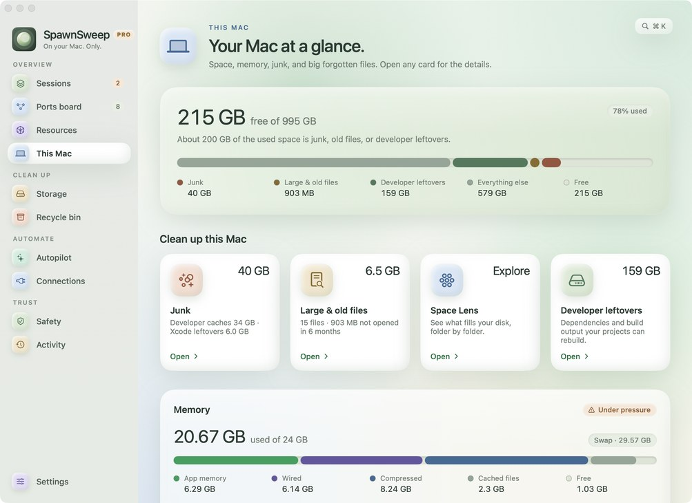
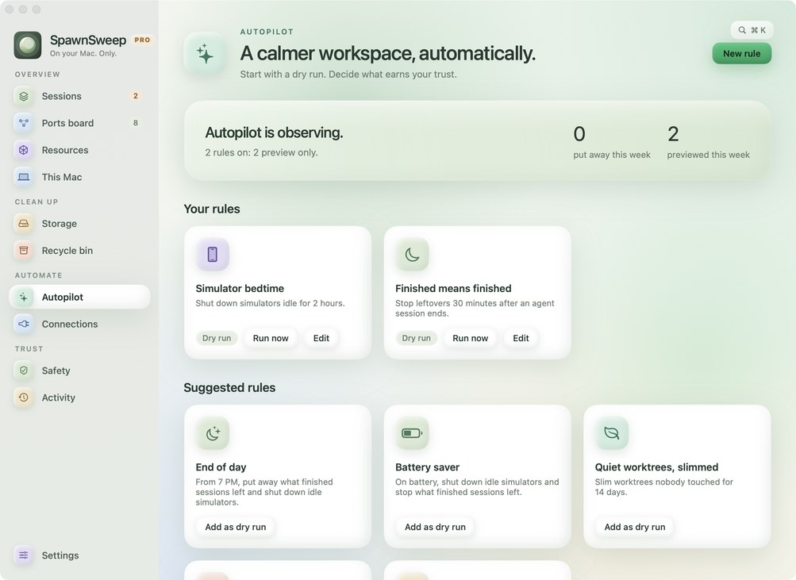
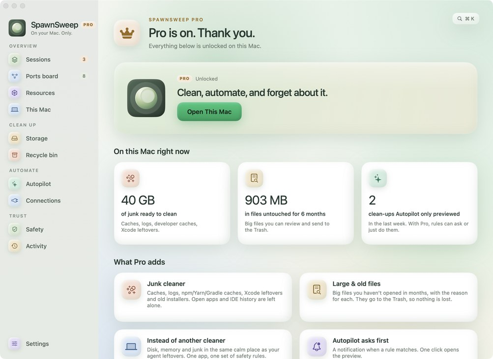

<p align="center">
  
</p>

<h1 align="center">SpawnSweep</h1>

<p align="center">
  <strong>The macOS menu bar cleaner for AI coding agents.</strong><br>
  Reclaim disk space and recover system resources after Claude Code, OpenAI Codex or Cursor. Review dev servers, ports, Git worktrees, simulators and Docker stacks before cleanup.
</p>

<p align="center">
  <a href="https://github.com/samirmaikap/spawnsweep/releases/latest/download/SpawnSweep.zip"></a>
  &nbsp;
  <a href="https://samirmaikap.dev/spawnsweep/"></a>
</p>

<p align="center">
  <a href="https://github.com/samirmaikap/spawnsweep/releases/latest"></a>
  
  <a href="LICENSE"></a>
  
  <a href="https://github.com/samirmaikap/spawnsweep/stargazers"></a>
</p>

<p align="center">
  
</p>

<p align="center">
  <a href="#install">Install</a> ·
  <a href="#highlights">Highlights</a> ·
  <a href="#inside-claude">Inside Claude</a> ·
  <a href="#spawnsweep-pro">Pro</a> ·
  <a href="#mac-cleanup-guides">Cleanup guides</a> ·
  <a href="#safety">Safety</a> ·
  <a href="#faq">FAQ</a>
</p>

---

## Clean up after AI coding agents on macOS

- `Error: Port 3000 is already in use`, again.
- Yesterday's `next dev`, `vite` and `vitest --watch`, still running from sessions you closed hours ago.
- An iPhone simulator holding 1.6 GB of memory since lunch.
- A hundred git worktrees, each with its own `node_modules`.

**SpawnSweep is a free, open-source Mac app that cleans up after AI coding agents.** It groups detected resources by agent session when it can identify their owner. Review what to stop or remove from Claude Code, the Claude desktop app, Codex, Cursor, Gemini CLI and Aider sessions.

Native SwiftUI for macOS 14 or later on Apple silicon. The core app is free and open source under the MIT license. SpawnSweep Pro is a one-time $9 purchase for up to 3 Macs. Cleanup scans run locally.

## Install

1. **[Download SpawnSweep.zip](https://github.com/samirmaikap/spawnsweep/releases/latest/download/SpawnSweep.zip)** from the project’s GitHub release.
2. Extract the ZIP and move **SpawnSweep.app** to Applications.
3. Open the app. The download includes Pro features that you can unlock with a key. The free features are available immediately.

If you prefer Terminal, [review the installer source](scripts/install.sh) first. The script downloads the latest release, replaces an existing copy in Applications or `~/Applications`, and launches the app.

```bash
curl -fsSL https://raw.githubusercontent.com/samirmaikap/spawnsweep/main/scripts/install.sh | bash
```

### If macOS says "SpawnSweep" Not Opened

The current release uses ad hoc signing. macOS can block its first launch. After verifying that your download came from the project’s GitHub release, open **System Settings → Privacy & Security** and use **Open Anyway** for SpawnSweep. See [release verification](reports/discovery/PRODUCT_TRUST.md#verify-the-release-before-running-it) for the ZIP digest and signing checks. You can also [build the free edition from source](#build-from-source).

## Highlights

<p align="center">
  
  
</p>

- **Detected agent sessions and resources.** Review dev servers, watchers, headless browsers and tunnels associated with Claude Code, the Claude app, Codex, Cursor, Gemini CLI and Aider.
- **A ports board.** See detected developer listeners with project, branch, uptime and session context where available. Review the process before freeing a port.
- **Git worktrees under control.** Size and status per repo. Slim the rebuildable folders, push and remove, or recycle merged ones, with eligible ignored files such as `.env` saved for restoration during the retention window.
- **Simulators and Docker.** Booted simulators and emulators, unused simulator devices, and Docker stacks, each stopped as one unit.
- **Know when something starts.** A notification when an agent session starts, a simulator boots or a worktree appears, each with its own switch.
- **Inside Claude.** A 🌔 with the count of what's running in Claude's footer opens a pane beside your chat. [More below](#inside-claude).
- **Autopilot.** Rules that start as dry runs: simulator bedtime, finished-session leftovers, end of day, battery saver, low disk, merged worktrees.
- **Review and recovery.** Manual previews, guarded process stops and an activity log with recovery actions where available. [Cleanup safeguards](#safety).

The menu bar shows what's running right now, memory used, disk free, and one button to put leftovers away.

## Mac cleanup guides

Start with the [AI coding agent cleanup checklist](https://samirmaikap.dev/spawnsweep/ai-coding-agent-cleanup/) for parallel projects, or follow a guide for [Claude Code](https://samirmaikap.dev/spawnsweep/claude-code-cleanup/), [Codex](https://samirmaikap.dev/spawnsweep/codex-cleanup/), or [Cursor](https://samirmaikap.dev/spawnsweep/cursor-cleanup/).

- [Find and free a localhost port](https://samirmaikap.dev/spawnsweep/localhost-port-cleaner/) or fix [port 3000 already in use](https://samirmaikap.dev/spawnsweep/port-3000-already-in-use-mac/).
- [Stop orphaned dev processes](https://samirmaikap.dev/spawnsweep/orphaned-process-cleaner/) or [stop a leftover Docker Compose stack](https://samirmaikap.dev/spawnsweep/docker-cleanup/).
- [Reclaim developer disk space](https://samirmaikap.dev/spawnsweep/developer-disk-cleaner/), [review old Git worktrees](https://samirmaikap.dev/spawnsweep/git-worktree-cleaner/), or [clean up unused Xcode simulators](https://samirmaikap.dev/spawnsweep/clean-up-xcode-simulators-mac/).
- [Compare scope with CleanMyMac](https://samirmaikap.dev/spawnsweep/cleanmymac-alternative/).

SpawnSweep is also listed on [OpenMacApps](https://openmacapps.com/apps/spawnsweep/) and [AlternativeTo](https://alternativeto.net/software/spawnsweep/about/).

## Inside Claude

A plugin for Claude Code and the Claude desktop app puts what SpawnSweep sees in a pane next to your chat: each agent session with its dev servers, ports and Docker stacks, loose simulators, and your git worktrees. A moon with the count of what's running (🌔 4) sits in the footer; click it, or type `/spawnsweep`, to open the pane. It refreshes every 30 seconds and needs SpawnSweep in Applications.

The easiest way to add it: open SpawnSweep and click **Add to Claude** on the Sessions page, or turn on **Connections › Claude Code pane**. Or, at the prompt of a Claude Code terminal session:

```
/plugin install spawnsweep --marketplace samirmaikap/spawnsweep
```

In the desktop app, click **+** next to the prompt box, then **Plugins**, **Add marketplace** with `samirmaikap/spawnsweep`, then **Add plugin**. The plugin's source and details are in [`claude-plugin/`](claude-plugin).

SpawnSweep also gives agents an MCP server they can ask "is a dev server already running for this repo?" before starting another one, and a Claude Code SessionEnd hook that puts away what a session started when it ends. Both are a click away in **Connections**.

## How it compares

| | By hand in Terminal | General Mac cleaners | SpawnSweep |
|---|---|---|---|
| **Leftover dev servers, watchers, headless browsers** | Find each one with `ps` or `lsof`, then `kill` it | Not their focus | Grouped by the agent session that started them, stopped gently after a preview |
| **Busy ports** | `lsof -i :3000`, one port at a time | Not their focus | Detected developer listeners with project, branch and session where available |
| **Which agent started what** | Inspect ancestry and working directories | Varies by tool | Associates known agent processes and resources when a link is available |
| **Git worktrees** | `git worktree list` and `remove`; ignored files like `.env` go with it | Not their focus | Size and status per repo; slim or recycle, and restore later |
| **Simulators and Xcode build data** | `xcrun simctl`, delete DerivedData folders | Some clear DerivedData | Lists sizes and reviews unused simulators and orphaned DerivedData. Pro adds broader cache cleanup. |
| **App caches, logs, large files** | `du` and manual deletion | Their core feature | With Pro |
| **Cleans up on its own** | Your own scripts | Scheduled scans | Autopilot rules that start as dry runs; acting on their own with Pro |

## SpawnSweep Pro

Everything above is free unless it says Pro. Pro adds the parts that clean your whole Mac and work on their own:

- **Junk cleaner**: app caches, logs, npm/Yarn/Gradle/Homebrew caches, Xcode leftovers and old installers. Open apps and IDE local history are left alone.
- **Large & old files**: big files you haven't opened in months, each with the reason, sent to the Trash so nothing is lost.
- **Autopilot that acts**: rules that ask first with a notification, or act on their own and log a way back.
- **Rules that run themselves**: clean up at the end of the day, battery saver when unplugged, room to breathe when the disk runs low.

The official download scans for free, so you can see what Pro would clean before you decide. Pro is a one-time $9 purchase through [Dodo Payments](https://dodopayments.com); the key arrives by email and you paste it into **Settings › SpawnSweep Pro** in the official download. Source builds don't include Pro, so a key does nothing there. A key works on up to 3 Macs and keeps working offline for weeks between checks.

<p align="center">
  <a href="https://checkout.dodopayments.com/buy/pdt_0Nqn3fOmfcDQwcQysr6t5?quantity=1"></a>
</p>

<p align="center">
  
</p>

## Safety

SpawnSweep deletes as little as possible and asks first.

- Manual cleanups start with a preview. Session sweeps skip active and pinned sessions.
- The process scan is scoped to your macOS user. Stops recheck the process start time before each signal, send TERM first, and use KILL for survivors.
- **Slim** removes only folders git ignores by their own name (`node_modules`, `.next`, `dist`, …), never a folder that holds tracked files, and never in a worktree something is running in.
- **Recycle** saves eligible ignored files under the backup limit (`.env`, keys, local databases) before `git worktree remove` (never `--force`). Branches stay in Git. Backups are capped at 500 MB. Restore can recreate the checkout and saved files during the retention period.
- **Junk (Pro)** only touches folders apps and tools can rebuild, re-checks each item right before removing it, refuses anything that resolves outside its folder, and skips caches of open apps and IDE local history.
- **Large files (Pro)** go to the Trash, never straight to deletion.
- Docker cleanup stops containers in the configured context. Check the [Docker context and auto-remove settings](https://samirmaikap.dev/spawnsweep/docker-cleanup/) before stopping a stack.

`SpawnSweep --selftest` runs the checks behind these rules (ignored-file rules, license grace, rule migration; the official build adds the cleaners' path-containment checks).

Stopping a process loses its live state. A relaunch can rerun its command when available. Automatic session sweeps skip weak or folder-only process matches. See [cleanup boundaries and recovery](reports/discovery/PRODUCT_TRUST.md#cleanup-boundaries) and [how to report a security issue](SECURITY.md).

## Privacy

SpawnSweep scans local resources on your Mac and collects no usage telemetry. Pro contacts Dodo Payments to activate, validate or deactivate a license. State lives in `~/Library/Application Support/SpawnSweep`. The Pro activation record lives in Keychain. The optional Claude pane and MCP tools share resource details with the configured agent client. [What the app stores and transmits](reports/discovery/PRODUCT_TRUST.md#privacy-and-local-state)

## FAQ

### How do I find what's using a port on my Mac?

In Terminal, `lsof -nP -iTCP:3000 -sTCP:LISTEN` shows the process listening on port 3000. SpawnSweep's **Ports board** shows detected developer listeners with project, branch, uptime and session context where available. Review the stop action to free a port.

### How do I stop the dev servers Claude Code or Codex left running?

Open **Sessions**. SpawnSweep groups detected dev servers, watchers, headless browsers and tunnels when it can identify their session. Review the cleanup and SpawnSweep stops them gently. The optional Claude Code SessionEnd hook can stop matched processes automatically when a session ends. Session sweeps skip active and pinned sessions.

### How do I clean up old git worktrees?

`git worktree list` shows them and `git worktree remove <path>` removes one. SpawnSweep's **Storage** page lists worktrees per repo with their status and size. It can slim a worktree (remove rebuildable folders like `node_modules`) or recycle a merged one after saving ignored files such as `.env`, so Restore can bring back the saved files during the retention window.

### How do I free disk space used by Xcode simulators?

Start with `xcrun simctl list devices unavailable` to review devices missing their runtime. Deleting a device removes its local apps and test data. SpawnSweep can preview unused device removal. [Review simulator devices and runtimes](https://samirmaikap.dev/spawnsweep/clean-up-xcode-simulators-mac/).

### Which AI coding agents does SpawnSweep support?

Claude Code, the Claude desktop app, Codex, Cursor, Gemini CLI and Aider. Detected processes are linked to sessions where possible. Resources may also appear in Ports or Resources without a session match.

### Is SpawnSweep a CleanMyMac alternative?

SpawnSweep focuses on developer sessions, dev servers, ports and worktrees. Pro adds app and developer cache cleanup. See the [developer cleanup comparison](https://samirmaikap.dev/spawnsweep/cleanmymac-alternative/) for the scope of each tool.

### Is SpawnSweep free?

Yes. The app and its source code are free under the MIT license. SpawnSweep Pro, a one-time $9 purchase for up to 3 Macs, unlocks the junk cleaner, large & old files, and Autopilot rules that act on their own.

## For scripts and agents

The app's binary has helpers you can run from Terminal (`/Applications/SpawnSweep.app/Contents/MacOS/SpawnSweep`, or `build/…` in a source build):

```bash
SpawnSweep --scan          # print what it sees
SpawnSweep --scan --json   # the same as JSON: sessions, what runs, simulators, worktrees
SpawnSweep --mcp           # MCP server (stdio) for agents
SpawnSweep --session-end   # Claude Code SessionEnd hook (reads JSON on stdin)
SpawnSweep --selftest      # run the safety checks
```

**Connections › Claude Code** installs the hook into `~/.claude/settings.json` (only its own entry, with a `.bak` copy). **Connections › Configure MCP** registers the MCP server with `claude mcp add`.

## Build from source

With Xcode 16 or the Swift 6 toolchain:

```bash
git clone https://github.com/samirmaikap/spawnsweep.git
cd spawnsweep
scripts/bundle.sh
open "build/SpawnSweep.app"
```

`bundle.sh` builds a release binary, wraps it in `build/SpawnSweep.app` with its icon, and signs it ad hoc. Building from source gives you the free edition; junk cleaning, large & old files and Autopilot's Ask first and Automatic modes are in SpawnSweep Pro, which comes with the official download.

```
Sources/SpawnSweep/
  Model/       Sessions, resources, worktrees, rules, prefs, activity
  Engine/      ProcessTable (ps + libproc + lsof), Scanner, DiskScanner, Junk, LargeFiles,
               SystemStats, Actions, License, Store, Shell
  App/         AppModel, Autopilot, app entry and menu bar, CLI (hook, MCP, JSON scan, self-test), integrations
  UI/          Theme (design system), RootView, dialogs, menu bar, pages
  Pro/         (private; not in this repo)
claude-plugin/ The SpawnSweep pane for Claude Code and the Claude app
docs/          The website (GitHub Pages) and DESIGN.md
```

## Support

SpawnSweep is made by one person. If it saved you a `kill -9` or gave you some disk space back:

- ⭐ **Star this repo.** It's how other developers find SpawnSweep.
- **[Get SpawnSweep Pro](#spawnsweep-pro).** It funds the free app and unlocks the cleaning and automation features.
- **Report bugs and ideas** in [Issues](https://github.com/samirmaikap/spawnsweep/issues). Pull requests are welcome.

## License

The source code is [MIT licensed](LICENSE). The SpawnSweep name and moon icon are not covered by that license; see [TRADEMARK.md](TRADEMARK.md).
