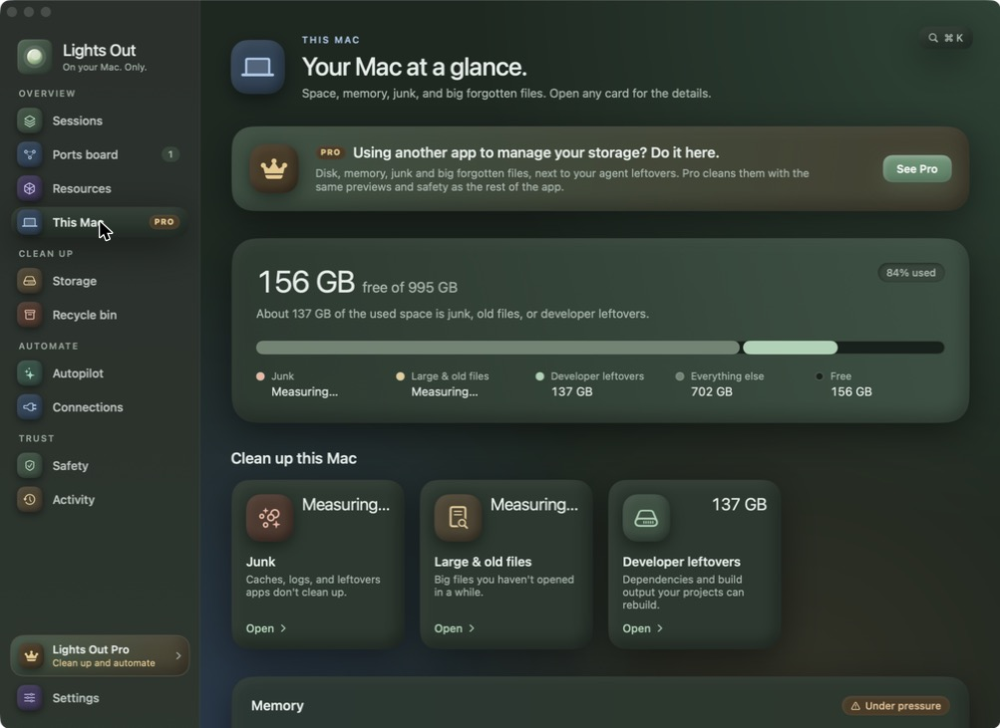
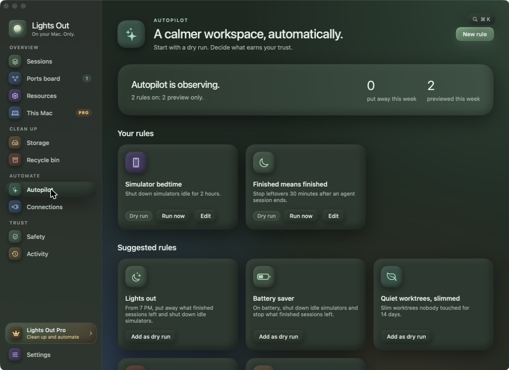
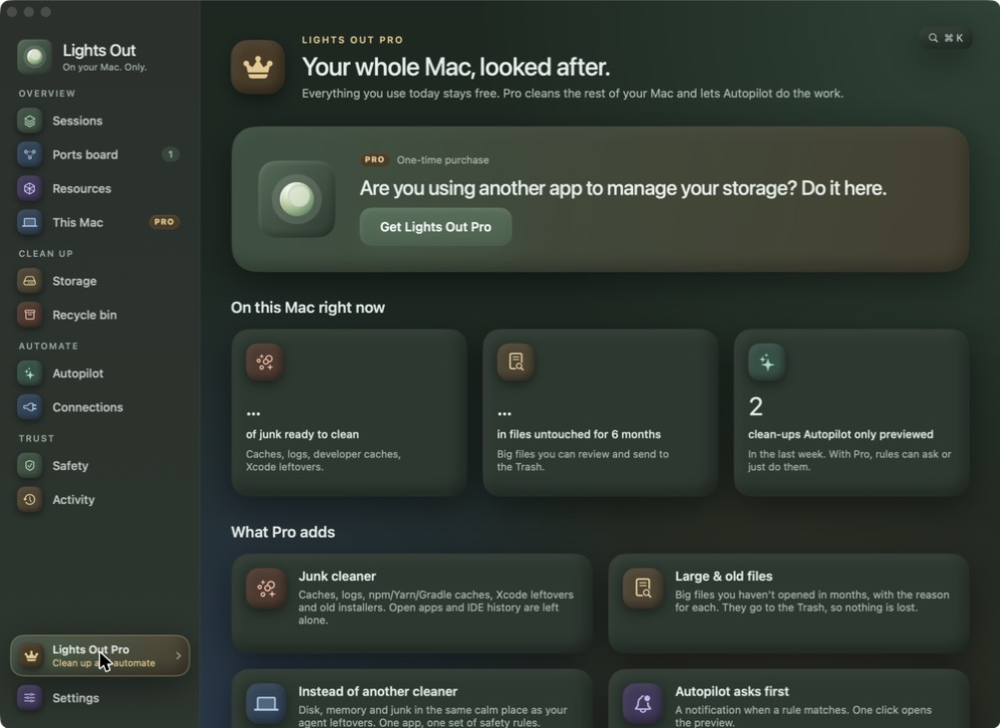

<p align="center">
  
</p>

<h1 align="center">SpawnSweep</h1>

<p align="center">
  A calm macOS menu bar app that shows what your AI coding agents left running, and puts it away without losing a line of work.
</p>

<p align="center">
  
</p>

<p align="center">
  <a href="#install">Install</a> ·
  <a href="#what-it-does">What it does</a> ·
  <a href="#spawnsweep-pro">Pro</a> ·
  <a href="#safety">Safety</a> ·
  <a href="#support">Support</a>
</p>

---

Claude Code, Codex, Cursor and friends start dev servers, watchers, headless browsers, simulators, Docker stacks and git worktrees. When the session ends, a lot of it keeps running and keeps taking space. SpawnSweep finds it, tells you which agent started it, and cleans up with a preview first, every time.

Native SwiftUI, macOS 14+. Everything stays on your Mac. No account, no telemetry.

<p align="center">
  
  
</p>

## Install

**Download** (macOS 14 or later, Apple silicon). The easiest way is to paste this into Terminal:

```bash
curl -fsSL https://raw.githubusercontent.com/samirmaikap/spawnsweep/main/scripts/install.sh | bash
```

It downloads the latest release into Applications and opens it, with no macOS warning. You can also download `SpawnSweep.zip` from [Releases](https://github.com/samirmaikap/spawnsweep/releases/latest), open it, and move SpawnSweep to Applications. The download includes SpawnSweep Pro, which a license key unlocks.

### If macOS says "SpawnSweep" Not Opened

SpawnSweep isn't notarized by Apple yet. The first time you open a copy downloaded in a browser, macOS says *Apple could not verify "SpawnSweep" is free of malware*. It shows this for every app that isn't notarized, and it only happens once.

1. Click **Done**, not Move to Bin.
2. Open **System Settings › Privacy & Security** and scroll to the bottom. Next to the message about SpawnSweep, click **Open Anyway**, then confirm with your password or Touch ID. The button only stays for a while after the warning; if you don't see it, open SpawnSweep again, then come back.
3. SpawnSweep opens, and macOS won't ask again.

Or clear the download flag in Terminal and open it normally (change the path if the app isn't in Applications):

```bash
xattr -dr com.apple.quarantine /Applications/SpawnSweep.app
```

**Build from source** (Xcode 16 or the Swift 6 toolchain):

```bash
git clone https://github.com/samirmaikap/spawnsweep.git
cd spawnsweep
scripts/bundle.sh
open "build/SpawnSweep.app"
```

`bundle.sh` builds a release binary, wraps it in `build/SpawnSweep.app` with its icon, and signs it ad hoc.

Building from source gives you the free edition. Junk cleaning, large & old files and Autopilot's Ask first and Automatic modes are in SpawnSweep Pro, which comes with the official download.

## What it does

| | |
|---|---|
| **Sessions** | Every agent session (Claude Code, Claude app, Codex, Cursor, Gemini, Aider) with what it still has running, and an end-of-day sweep |
| **Ports board** | Every localhost listener with its project, branch, uptime and session. Free a port in one click |
| **Resources** | Booted simulators and emulators, unused simulator devices, Docker stacks, watchers and headless browsers |
| **This Mac** | Disk and memory at a glance, measured next to your agent leftovers. Pro adds junk and large & old files |
| **Storage** | Worktrees per repo with status and size. Slim them (remove rebuildable folders), push and remove, recycle merged ones |
| **Recycle bin** | Removed worktrees with their branch, commit and saved ignored files. Restore within the retention window |
| **Autopilot** | Rules that start as dry runs: simulator bedtime, finished-session leftovers, end of day, battery saver, low disk, merged worktrees |
| **Connections** | Agent detection, a Claude Code SessionEnd hook, and an MCP server agents can ask before starting another dev server |
| **Safety & Activity** | Public tunnels, `.env` copies (locations only), protected sessions and ports, and a log of every change with its way back |

The menu bar shows what's running right now, memory used, disk free, and one button to put leftovers away.

## SpawnSweep Pro

Everything above is free unless it says Pro. Pro adds the parts that clean your whole Mac and work on their own:

- **Junk cleaner**: app caches, logs, npm/Yarn/Gradle/Homebrew caches, Xcode leftovers and old installers. Open apps and IDE local history are left alone.
- **Large & old files**: big files you haven't opened in months, each with the reason, sent to the Trash so nothing is lost.
- **Autopilot that acts**: rules that ask first with a notification, or act on their own and log a way back.
- **Rules that run themselves**: clean up at the end of the day, battery saver when unplugged, room to breathe when the disk runs low.

The official download scans for free, so you can see what Pro would clean before you decide. Pro is a one-time purchase through [Dodo Payments](https://dodopayments.com); the key arrives by email and you paste it into **Settings › SpawnSweep Pro** in the official download. Source builds don't include Pro, so a key does nothing there.

A key works on up to 3 Macs and keeps working offline for weeks between checks.

**[Get SpawnSweep Pro](https://checkout.dodopayments.com/buy/pdt_0Nqn3fOmfcDQwcQysr6t5?quantity=1)**

<p align="center">
  
</p>

## Safety

SpawnSweep deletes as little as possible and asks first.

- Every change starts with a preview. Active and pinned sessions are never swept.
- Processes are checked by start time before they're signalled, stopped gently (TERM, up to 10 seconds, then KILL), and never outside your user or inside `/Applications`.
- **Slim** removes only folders git ignores by their own name (`node_modules`, `.next`, `dist`, …), never a folder that holds tracked files, and never in a worktree something is running in.
- **Recycle** saves every ignored file that can't be rebuilt (`.env`, keys, local databases) before `git worktree remove` (never `--force`). Branches stay in git and Restore brings everything back.
- **Junk (Pro)** only touches folders apps and tools can rebuild, re-checks each item right before removing it, refuses anything that resolves outside its folder, and skips caches of open apps and IDE local history.
- **Large files (Pro)** go to the Trash, never straight to deletion.
- Docker volumes are never touched.

`SpawnSweep --selftest` runs the checks behind these rules (ignored-file rules, license grace, rule migration; the official build adds the cleaners' path-containment checks).

## Helpers in the same binary

```bash
"build/SpawnSweep.app/Contents/MacOS/SpawnSweep" --scan          # print what it sees
"build/SpawnSweep.app/Contents/MacOS/SpawnSweep" --mcp           # MCP server (stdio) for agents
"build/SpawnSweep.app/Contents/MacOS/SpawnSweep" --session-end   # Claude Code SessionEnd hook (reads JSON on stdin)
"build/SpawnSweep.app/Contents/MacOS/SpawnSweep" --selftest      # run the safety checks
```

**Connections › Claude Code** installs the hook into `~/.claude/settings.json` (only its own entry, with a `.bak` copy). **Connections › Configure MCP** registers the MCP server with `claude mcp add`.

## Privacy

SpawnSweep runs locally and sends nothing about your Mac anywhere. The only network call checks a Pro license key with Dodo Payments, about once a week. Builds from this source make no network calls. State lives in `~/Library/Application Support/SpawnSweep`; a Pro key lives in your Keychain.

## Project layout

```
Sources/SpawnSweep/
  Model/       Sessions, resources, worktrees, rules, prefs, activity
  Engine/      ProcessTable (ps + libproc + lsof), Scanner, DiskScanner, Junk, LargeFiles,
               SystemStats, Actions, License, Store, Shell
  App/         AppModel, Autopilot, app entry and menu bar, CLI (hook, MCP, self-test), integrations
  UI/          Theme (design system), RootView, dialogs, menu bar, pages
  Pro/         (private; not in this repo)
docs/DESIGN.md Design guidelines
```

## Support

SpawnSweep is made by one person. If it gave you some disk space back, the best way to support it is [SpawnSweep Pro](#spawnsweep-pro): it funds the free app and unlocks the cleaning and automation features. Bug reports and pull requests are welcome in [Issues](https://github.com/samirmaikap/spawnsweep/issues).

## License

The source code is [MIT licensed](LICENSE). The SpawnSweep name and moon icon are not covered by that license; see [TRADEMARK.md](TRADEMARK.md).
