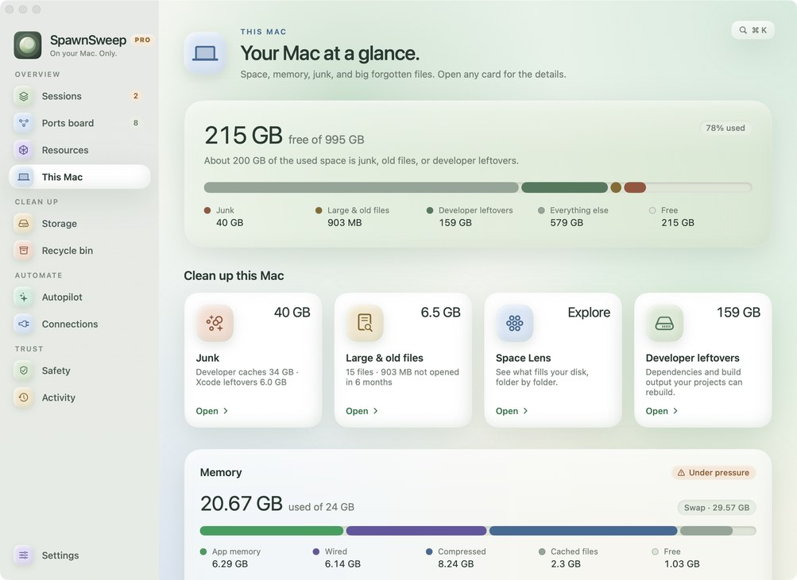
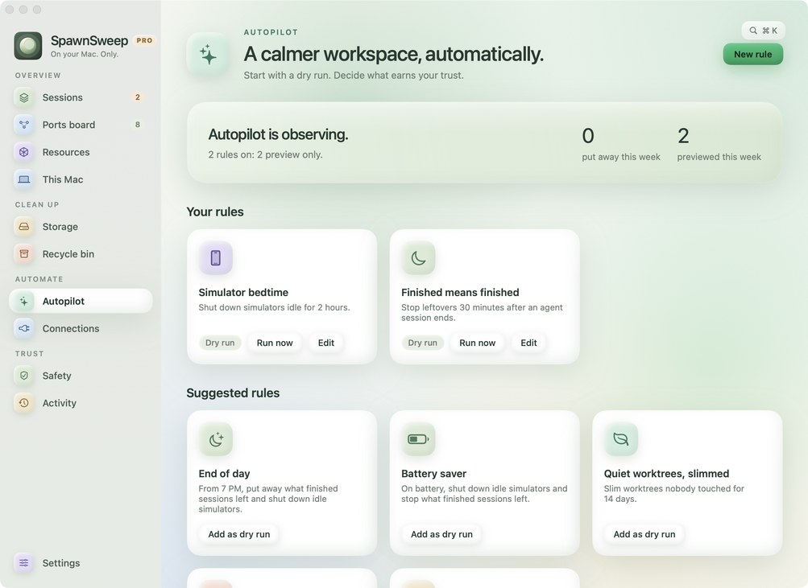
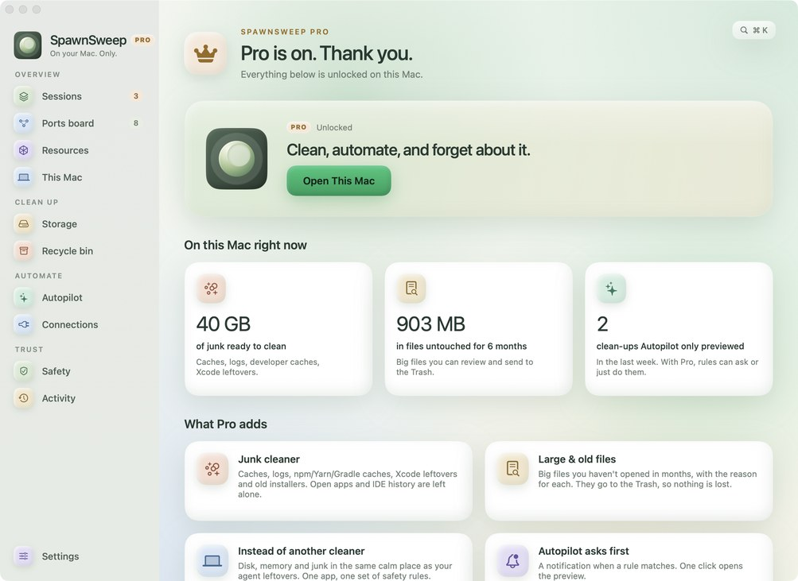

<p align="center">
  
</p>

<h1 align="center">SpawnSweep</h1>

<p align="center">
  <strong>The macOS menu bar cleaner for AI coding agents.</strong><br>
  See what Claude Code, Codex and Cursor left running on your Mac, and put it away without losing a line of work.
</p>

<p align="center">
  <a href="https://github.com/samirmaikap/spawnsweep/releases/latest/download/SpawnSweep.zip"></a>
  &nbsp;
  <a href="https://samirmaikap.github.io/spawnsweep/"></a>
</p>

<p align="center">
  <a href="https://github.com/samirmaikap/spawnsweep/releases/latest"></a>
  
  <a href="LICENSE"></a>
  
  <a href="https://github.com/samirmaikap/spawnsweep/stargazers"></a>
</p>

<p align="center">
  
</p>

<p align="center">
  <a href="#install">Install</a> ·
  <a href="#highlights">Highlights</a> ·
  <a href="#inside-claude">Inside Claude</a> ·
  <a href="#spawnsweep-pro">Pro</a> ·
  <a href="#safety">Safety</a> ·
  <a href="#faq">FAQ</a>
</p>

---

## Your agents start things. Nobody stops them.

- `Error: Port 3000 is already in use`, again.
- Yesterday's `next dev`, `vite` and `vitest --watch`, still running from sessions you closed hours ago.
- An iPhone simulator holding 1.6 GB of memory since lunch.
- A hundred git worktrees, each with its own `node_modules`.

**SpawnSweep is a free, open-source Mac app that cleans up after AI coding agents.** It finds the dev servers, busy ports, simulators, Docker stacks and git worktrees that Claude Code, Codex, Cursor, Gemini and Aider leave behind, tells you which session started each one, and puts them away with a preview first, every time.

Native SwiftUI for macOS 14 or later on Apple silicon. Free and open source (MIT); SpawnSweep Pro is a one-time $9 for up to 3 Macs. Everything stays on your Mac. No account, no telemetry.

## Install

Paste this into Terminal. It downloads the latest release into Applications and opens it, with no macOS warning:

```bash
curl -fsSL https://raw.githubusercontent.com/samirmaikap/spawnsweep/main/scripts/install.sh | bash
```

Or **[download SpawnSweep.zip](https://github.com/samirmaikap/spawnsweep/releases/latest/download/SpawnSweep.zip)**, open it, and move SpawnSweep to Applications. The download includes SpawnSweep Pro, which a license key unlocks; everything free works right away.

### If macOS says "SpawnSweep" Not Opened

SpawnSweep isn't notarized by Apple yet. The first time you open a copy downloaded in a browser, macOS says *Apple could not verify "SpawnSweep" is free of malware*. It shows this for every app that isn't notarized, and it only happens once.

1. Click **Done**, not Move to Bin.
2. Open **System Settings › Privacy & Security** and scroll to the bottom. Next to the message about SpawnSweep, click **Open Anyway**, then confirm with your password or Touch ID. The button only stays for a while after the warning; if you don't see it, open SpawnSweep again, then come back.
3. SpawnSweep opens, and macOS won't ask again.

Or clear the download flag in Terminal and open it normally (change the path if the app isn't in Applications):

```bash
xattr -dr com.apple.quarantine /Applications/SpawnSweep.app
```

## Highlights

<p align="center">
  
  
</p>

- **Every agent session, and what it left running.** Claude Code, the Claude app, Codex, Cursor, Gemini and Aider, each with its dev servers, watchers, headless browsers and tunnels. Put a finished session away in one click, or sweep them all at the end of the day.
- **A ports board.** Every localhost listener with its project, git branch, uptime and the session that started it. Free a port in one click.
- **Git worktrees under control.** Size and status per repo. Slim the rebuildable folders, push and remove, or recycle merged ones, with `.env` and other ignored files saved so Restore brings everything back.
- **Simulators and Docker.** Booted simulators and emulators, unused simulator devices, and Docker stacks, each stopped as one unit.
- **Know when something starts.** A notification when an agent session starts, a simulator boots or a worktree appears, each with its own switch.
- **Inside Claude.** A 🌔 with the count of what's running in Claude's footer opens a pane beside your chat. [More below](#inside-claude).
- **Autopilot.** Rules that start as dry runs: simulator bedtime, finished-session leftovers, end of day, battery saver, low disk, merged worktrees.
- **Safe by design.** A preview before every change, gentle stops, and a log of every change with its way back. [The rules](#safety).

The menu bar shows what's running right now, memory used, disk free, and one button to put leftovers away.

## Inside Claude

A plugin for Claude Code and the Claude desktop app puts what SpawnSweep sees in a pane next to your chat: each agent session with its dev servers, ports and Docker stacks, loose simulators, and your git worktrees. A moon with the count of what's running (🌔 4) sits in the footer; click it, or type `/spawnsweep`, to open the pane. It refreshes every 30 seconds and needs SpawnSweep in Applications.

The easiest way to add it: open SpawnSweep and click **Add to Claude** on the Sessions page, or turn on **Connections › Claude Code pane**. Or, at the prompt of a Claude Code terminal session:

```
/plugin install spawnsweep --marketplace samirmaikap/spawnsweep
```

In the desktop app, click **+** next to the prompt box, then **Plugins**, **Add marketplace** with `samirmaikap/spawnsweep`, then **Add plugin**. The plugin's source and details are in [`claude-plugin/`](claude-plugin).

SpawnSweep also gives agents an MCP server they can ask "is a dev server already running for this repo?" before starting another one, and a Claude Code SessionEnd hook that puts away what a session started when it ends. Both are a click away in **Connections**.

## How it compares

| | By hand in Terminal | General Mac cleaners | SpawnSweep |
|---|---|---|---|
| **Leftover dev servers, watchers, headless browsers** | Find each one with `ps` or `lsof`, then `kill` it | Not their focus | Grouped by the agent session that started them, stopped gently after a preview |
| **Busy ports** | `lsof -i :3000`, one port at a time | Not their focus | Every listener with its project, branch and session; free one in a click |
| **Which agent started what** | Can't tell | Can't tell | Every session: Claude Code, Codex, Cursor, Gemini, Aider |
| **Git worktrees** | `git worktree list` and `remove`; ignored files like `.env` go with it | Not their focus | Size and status per repo; slim or recycle, and restore later |
| **Simulators and Xcode build data** | `xcrun simctl`, delete DerivedData folders | Some clear DerivedData | Sizes listed, unused simulators removed; DerivedData with Pro |
| **App caches, logs, large files** | `du` and manual deletion | Their core feature | With Pro |
| **Cleans up on its own** | Your own scripts | Scheduled scans | Autopilot rules that start as dry runs; acting on their own with Pro |

## SpawnSweep Pro

Everything above is free unless it says Pro. Pro adds the parts that clean your whole Mac and work on their own:

- **Junk cleaner**: app caches, logs, npm/Yarn/Gradle/Homebrew caches, Xcode leftovers and old installers. Open apps and IDE local history are left alone.
- **Large & old files**: big files you haven't opened in months, each with the reason, sent to the Trash so nothing is lost.
- **Autopilot that acts**: rules that ask first with a notification, or act on their own and log a way back.
- **Rules that run themselves**: clean up at the end of the day, battery saver when unplugged, room to breathe when the disk runs low.

The official download scans for free, so you can see what Pro would clean before you decide. Pro is a one-time $9 purchase through [Dodo Payments](https://dodopayments.com); the key arrives by email and you paste it into **Settings › SpawnSweep Pro** in the official download. Source builds don't include Pro, so a key does nothing there. A key works on up to 3 Macs and keeps working offline for weeks between checks.

<p align="center">
  <a href="https://checkout.dodopayments.com/buy/pdt_0Nqn3fOmfcDQwcQysr6t5?quantity=1"></a>
</p>

<p align="center">
  
</p>

## Safety

SpawnSweep deletes as little as possible and asks first.

- Every change starts with a preview. Active and pinned sessions are never swept.
- Processes are checked by start time before they're signalled, stopped gently (TERM, up to 10 seconds, then KILL), and never outside your user or inside `/Applications`.
- **Slim** removes only folders git ignores by their own name (`node_modules`, `.next`, `dist`, …), never a folder that holds tracked files, and never in a worktree something is running in.
- **Recycle** saves every ignored file that can't be rebuilt (`.env`, keys, local databases) before `git worktree remove` (never `--force`). Branches stay in git and Restore brings everything back.
- **Junk (Pro)** only touches folders apps and tools can rebuild, re-checks each item right before removing it, refuses anything that resolves outside its folder, and skips caches of open apps and IDE local history.
- **Large files (Pro)** go to the Trash, never straight to deletion.
- Docker volumes are never touched.

`SpawnSweep --selftest` runs the checks behind these rules (ignored-file rules, license grace, rule migration; the official build adds the cleaners' path-containment checks).

## Privacy

SpawnSweep runs locally and sends nothing about your Mac anywhere. The only network call checks a Pro license key with Dodo Payments, about once a week. Builds from this source make no network calls. State lives in `~/Library/Application Support/SpawnSweep`; a Pro key lives in your Keychain.

## FAQ

### How do I find what's using a port on my Mac?

In Terminal, `lsof -nP -iTCP:3000 -sTCP:LISTEN` shows the process listening on port 3000. SpawnSweep's **Ports board** lists every localhost listener at once, with its project, git branch, uptime and the agent session that started it, and frees a port in one click.

### How do I stop the dev servers Claude Code or Codex left running?

Open **Sessions**. SpawnSweep groups processes by the agent session that started them, so a finished session shows exactly what it left behind: dev servers, watchers, headless browsers, tunnels. Review the cleanup and SpawnSweep stops them gently. With the Claude Code SessionEnd hook installed, this happens on its own when a session ends. Active and pinned sessions are never touched.

### How do I clean up old git worktrees?

`git worktree list` shows them and `git worktree remove <path>` removes one. SpawnSweep's **Storage** page lists worktrees per repo with their status and size. It can slim a worktree (remove rebuildable folders like `node_modules`) or recycle a merged one after saving ignored files such as `.env`, so Restore brings everything back.

### How do I free disk space used by Xcode simulators?

`xcrun simctl delete unavailable` removes simulators for runtimes you no longer have. SpawnSweep's **Storage** page lists simulator devices and Xcode DerivedData by size and removes unused simulator devices with a preview. SpawnSweep Pro's junk cleaner also clears DerivedData.

### Which AI coding agents does SpawnSweep support?

Claude Code, the Claude desktop app, Codex, Cursor, Gemini and Aider. Processes are matched to the session that started them. Anything else listening on a port still shows up on the Ports board.

### Is SpawnSweep a CleanMyMac alternative?

For developers, mostly. SpawnSweep cleans what general Mac cleaners don't see: agent sessions, dev servers, busy ports, git worktrees and Docker stacks. SpawnSweep Pro adds the classic cleaning: app and developer caches, logs, old installers, and large & old files. It isn't an antivirus or an app uninstaller.

### Is SpawnSweep free?

Yes. The app and its source code are free under the MIT license. SpawnSweep Pro, a one-time $9 purchase for up to 3 Macs, unlocks the junk cleaner, large & old files, and Autopilot rules that act on their own.

## For scripts and agents

The app's binary has helpers you can run from Terminal (`/Applications/SpawnSweep.app/Contents/MacOS/SpawnSweep`, or `build/…` in a source build):

```bash
SpawnSweep --scan          # print what it sees
SpawnSweep --scan --json   # the same as JSON: sessions, what runs, simulators, worktrees
SpawnSweep --mcp           # MCP server (stdio) for agents
SpawnSweep --session-end   # Claude Code SessionEnd hook (reads JSON on stdin)
SpawnSweep --selftest      # run the safety checks
```

**Connections › Claude Code** installs the hook into `~/.claude/settings.json` (only its own entry, with a `.bak` copy). **Connections › Configure MCP** registers the MCP server with `claude mcp add`.

## Build from source

With Xcode 16 or the Swift 6 toolchain:

```bash
git clone https://github.com/samirmaikap/spawnsweep.git
cd spawnsweep
scripts/bundle.sh
open "build/SpawnSweep.app"
```

`bundle.sh` builds a release binary, wraps it in `build/SpawnSweep.app` with its icon, and signs it ad hoc. Building from source gives you the free edition; junk cleaning, large & old files and Autopilot's Ask first and Automatic modes are in SpawnSweep Pro, which comes with the official download.

```
Sources/SpawnSweep/
  Model/       Sessions, resources, worktrees, rules, prefs, activity
  Engine/      ProcessTable (ps + libproc + lsof), Scanner, DiskScanner, Junk, LargeFiles,
               SystemStats, Actions, License, Store, Shell
  App/         AppModel, Autopilot, app entry and menu bar, CLI (hook, MCP, JSON scan, self-test), integrations
  UI/          Theme (design system), RootView, dialogs, menu bar, pages
  Pro/         (private; not in this repo)
claude-plugin/ The SpawnSweep pane for Claude Code and the Claude app
docs/          The website (GitHub Pages) and DESIGN.md
```

## Support

SpawnSweep is made by one person. If it saved you a `kill -9` or gave you some disk space back:

- ⭐ **Star this repo.** It's how other developers find SpawnSweep.
- **[Get SpawnSweep Pro](#spawnsweep-pro).** It funds the free app and unlocks the cleaning and automation features.
- **Report bugs and ideas** in [Issues](https://github.com/samirmaikap/spawnsweep/issues). Pull requests are welcome.

## License

The source code is [MIT licensed](LICENSE). The SpawnSweep name and moon icon are not covered by that license; see [TRADEMARK.md](TRADEMARK.md).
